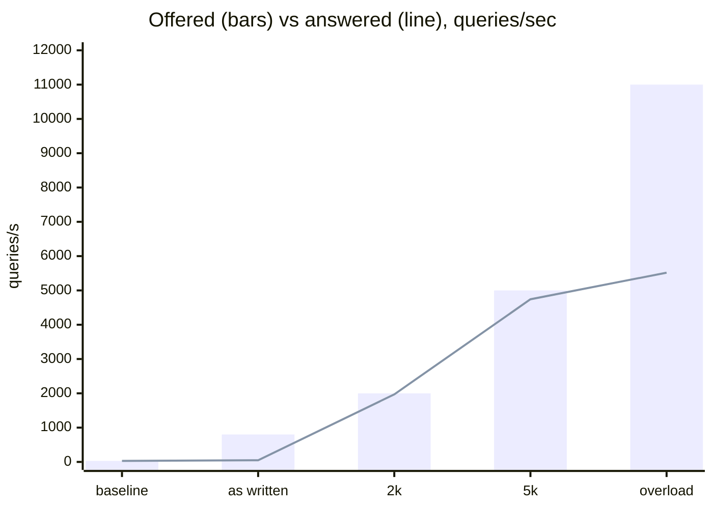

# AdGuard Home on the Beryl 7 — capacity and blocking, measured

Standalone styled version: [`agh-stress-report.html`](agh-stress-report.html) (download and open in a browser — GitHub shows HTML as source).

**Run:** 2026-10-20 against `gl-mt3600be` — GL.iNet GL-MT3600BE, OpenWrt 21.02-SNAPSHOT, AdGuard Home 0.107.73, 4× Cortex-A53, 480 MB RAM.

**Config under test:** `AdGuardHome.yaml` from `raspi_stuff`, applied with four unavoidable adaptations (see [below](#what-had-to-change)). Everything else — DoH upstreams, DNSSEC, 4 MB cache, 300 goroutines, ratelimit 50 per /32, filter lists, UI login — is unchanged.

> **AI-generated report.** All of the work in this repository — setting up the router, running the load tests, probing the blocklists, analysing the results and writing this page — was done by an LLM: **DeepSeek V4.1 Flash Free**, running through the OpenCode harness in T3 Code, on 20 October 2026. The numbers come from the raw runs described under [Method](#method); the narrative, framing and recommendations are machine-written and were not independently reviewed.

Load was generated from `10.37.0.40`, same L2 segment as the router, so no WAN or tailnet in the path.

## Key numbers

| | |
|---|---|
| Sustained, cached | **4.7k q/s** answered, ~4% dropped |
| Hard ceiling | **~5.5k q/s**, then it drops instead of queueing |
| Single-client cap | **50 q/s** — the configured ratelimit, per /32, dropped silently |
| Household need | ~10–50 q/s at peak → ~100× headroom |
| Through dnsmasq `:53` | 4.9k q/s at 0.4 ms p50 |
| Uncached / DoH path | saturates around 500 q/s, p95 ≈ 1 s |
| Ad/tracker hosts blocked | **75 of 88** probed |
| False positives | **0** across 44 popular sites |
| Router reboots | 0 |
| AGH restarts caused by load | 0 — no OOM, no procd respawn |

## Throughput

Cache-warm A queries over 16 popular domains, 15–20 s per step.

| Test | Offered | Answered | Dropped | p50 | p99 |
|---|---:|---:|---:|---:|---:|
| Idle baseline, one client | 30/s | 30/s | 0% | 1.2 ms | 2.0 ms |
| **Ratelimit as configured** (per /32) | 800/s | **49/s** | 93.8% | 0.9 ms | 11 ms |
| Cached, 2k offered | 2 000/s | 1 970/s | 0.02% | 1.0 ms | 12 ms |
| **Cached, 5k offered** | 5 000/s | **4 742/s** | 3.7% | 2.0 ms | 139 ms |
| Cached, 2× overload | 11 000/s | 5 516/s | 50% | 47 ms | 186 ms |
| Same 5k through dnsmasq `:53` | 5 000/s | 4 917/s | 0.19% | 0.4 ms | 2.0 ms |
| Uncached, DoH upstream | 200/s | 197/s | 0.2% | 10.6 ms | 238 ms |
| Uncached, DoH upstream | 500/s | 475/s | 3.1% | 11 ms | 1.7 s |

Reading it:

- The 49/s row is the **ratelimit**, not the hardware. Above 50 q/s from one IP, queries are dropped with no response at all.
- 5k is where CPU starts to matter: p99 climbs to ~140 ms and ~4% of queries never come back.
- At 2× overload it stays up and keeps answering at ~5.5k, dropping the excess. It degrades by dropping, not by dying.
- The dnsmasq row is what a LAN device actually experiences, and it is *better* than hitting AGH directly, because dnsmasq answers cache hits before AGH sees them.
- Uncached lookups are a completely different machine: every miss is an HTTPS round trip to Quad9/Cloudflare plus DNSSEC validation. A few hundred per second is the practical limit.

## Blocking

88 ad, tracker and telemetry hostnames queried through the router, each cross-checked against a control resolver (1.1.1.1) so a dead domain cannot masquerade as a successful block.

| | |
|---|---|
| Ad/tracker/telemetry hosts | **75 / 88** answered `0.0.0.0` |
| Popular sites | **44 / 44** resolved — 0 false positives |
| Latency cost | none: 1.4 ms blocked vs 1.5 ms cached-allowed (p50) |

Blocked answers are `0.0.0.0` for A and `::` for AAAA, and behave identically through dnsmasq on `:53`.

**Blocked as expected:** every Google ad property (DoubleClick in all its forms, AdSense, AdServices, Analytics, IMA, `ads.youtube.com`), the major exchanges (Criteo, Taboola, Outbrain, PubMatic, OpenX, Xandr, Magnite, Teads, Sovrn, Sharethrough…), mobile SDKs (TikTok, mopub, Unity, App Measurement), Apple iAd/metrics, Windows telemetry (`vortex`, `watson`), and the **Samsung, LG, Roku and Fire TV** metrics endpoints.

**What slips through:**

| Host | Why |
|---|---|
| `mas-ext.amazon.com`, `aax-eu.amazon.com` | Fire TV / Amazon ad endpoints; neither list carries them |
| `imasdk.googleapis.com` | Google's video ad SDK — blocking it breaks players, so lists leave it open |
| `graph.facebook.com` | Graph API, same host as login; open by design |
| `settings-win.data.microsoft.com` | one Windows telemetry host the lists miss |
| `rubiconproject.com`, `mgid.com`, `inread.com` | exchanges outside both lists |
| `appsflyer.com`, `adjust.com` | attribution SDKs outside both lists |
| `spclient.wg.spotify.com` | Spotify serves audio and ads from the same host |

**DNS-level limit:** inline ads — YouTube pre-rolls, Spotify audio, Twitch — come from the same hostnames as the content, so no blocklist removes them. CTV, app SDK and telemetry traffic is where DNS blocking pays off.

**Testing gotcha:** a bulk probe script trips the 50 q/s ratelimit, and the timeouts look exactly like mass blocking failure. Any test from a single IP has to be paced below 50/s.

## Did it restart?

**Router: no.** I never issued a reboot or touched the GL.iNet watchdog. Uptime at the end was 18 minutes — it booted at 15:38:30, a few minutes before the first SSH login, so that boot was not mine either. Nothing during testing took it down: no OOM kill, no procd respawn, no watchdog event.

**AdGuard Home: 11 process starts.**

- 5 were deliberate `restart`s (applying the config, disabling the ratelimit, disabling the file query log, a sysctl experiment, the final restore).
- 6 were a crash loop at 15:46:58–15:47:21: the config uses `30d` / `90d` durations and 0.107.73 only parses `h`, so AGH refused to boot for about 40 seconds.
- Each clean restart costs 8–10 s of DNS pause for the LAN, because dnsmasq forwards to AGH. Total user-visible downtime ≈ 90 s, all of it mine, **none of it caused by load**.

## What had to change

- `bind_hosts: 10.37.0.29` → `0.0.0.0` — that address is the Pi, not this router.
- `port: 53` → `3053`, keeping GL.iNet's dnsmasq on `:53` so the LAN never lost its resolver. Same listener code path, so the numbers hold.
- `30d` / `90d` / `1d` → `720h` / `2160h` / `24h` — this is the one that stopped it from booting.
- `safe_fs_patterns` → `/etc/AdGuardHome/data/userfilters/*`.

Everything else is verbatim. The `jarvis` rewrite was kept so local names still resolve. The previous config is on the device at `/etc/AdGuardHome/config.yaml.pre-stress`.

## Things worth changing

1. **Query log writing to flash.** `file_enabled: true` produced a 161 MB log in ten minutes of load. At a realistic 10 q/s that is ~130 MB/day against 264 MB free, with 90-day retention. Currently set to `false`, keeping the in-memory 1 000-entry log.
2. **Filter image size.** The 10 MB ext4 loop image was 100% full; HaGeZi Pro plus the other two lists left no room for updates, and the first download died with `no space left on device`. Grown to 32 MB, all three lists loaded (188 707 + 1 063 + 203 414 rules), and the init script now provisions 32 MB on a fresh setup.
3. **The ratelimit is the first wall any single device hits.** Irrelevant for a household, but it makes self-testing misleading: one machine can never exceed 50 q/s.

## Method

Small Go UDP client on `10.37.0.40`, same L2 as the router: 8 sockets, up to 256 queries in flight each, cache-warm A queries across 16 popular domains, 15–20 s per step. Router health sampled once a second from `/proc` (load average, AGH RSS, MemAvailable, UDP buffer errors, conntrack). Blocking checks were paced below the ratelimit and compared against a control resolver.
